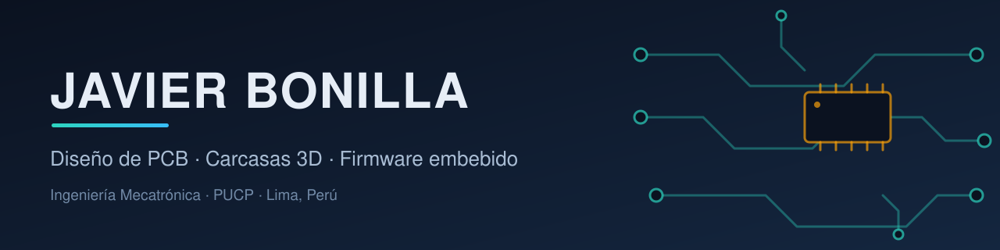

  

Estudiante de **Ingeniería Mecatrónica en la PUCP** (Lima, Perú). Diseño PCB de 2 y 4 capas, carcasas 3D en Autodesk Inventor y firmware para ESP32-S3, y fabrico mis propios dispositivos: relojes inteligentes, una calculadora gráfica programable y un asistente de voz.

### 👉 [Portafolio completo, con fotos, especificaciones y decisiones de diseño](https://github.com/C-137J/portfolio)

<table>
  <tr>
    <td width="33%" valign="top" align="center">
       
      <b>JNOX Watch V4</b> PCB de 4 capas · AMOLED táctil · carcasa sellada en PA12
    </td>
    <td width="33%" valign="top" align="center">
       
      <b>JNOX Watch V3</b> PCB de 2 capas · GPS · asistente de voz · 1 unidad vendida
    </td>
    <td width="33%" valign="top" align="center">
       
      <b>JNOX SCI v0</b> Calculadora gráfica programable · carcasa en PLA
    </td>
  </tr>
</table>

## Lo que hago

- **PCB**: esquemático y layout en EasyEDA Pro, 2 y 4 capas, alimentación y carga, interfaces I2C, SPI, UART, I2S y QSPI, fabricación en JLCPCB y soldadura SMD propia.
- **Carcasas 3D**: diseño en Autodesk Inventor para nylon PA12, resina SLA y PLA; sellado, holguras y planos de fabricación.
- **Firmware**: C++ sobre ESP32-S3 con LVGL, BLE, Wi-Fi y ESP-NOW.
- **Transparencia**: el diseño de las PCB y de las carcasas es mío; el código de las apps y parte del firmware lo desarrollé con ayuda de herramientas de IA.

## Enlaces

El código, los esquemáticos y los archivos de fabricación de mis proyectos no son públicos; los muestro en entrevista.
